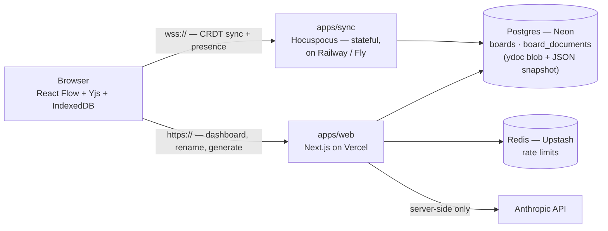

# Multiplayer Visual Canvas

A real-time collaborative canvas for logic and process flowcharts — several
people build a graph together on an infinite pane, and an AI assistant can
sketch one from a prompt. A focused, node-based slice of Miro/FigJam.

It's a portfolio reference implementation, built to get three genuinely hard
things right rather than to be a product:

- **Conflict-free multiplayer.** Edits sync through Yjs (a CRDT) over a
  self-hosted Hocuspocus WebSocket server. Two people typing in the same block
  merge character-by-character; nobody's work is clobbered.
- **Multiplayer-correct undo.** `Ctrl+Z` reverts *your* last change and only
  yours — it never touches what a collaborator did in parallel. One `Y.UndoManager`
  per client, scoped by transaction origin.
- **An AI layer that cannot corrupt the shared document.** Claude proposes
  structure; deterministic code owns every guarantee. The model never sees or
  picks coordinates, never supplies an id that's trusted, and can only *add* —
  the whole generation lands in one Yjs transaction, undone by one keystroke.

---

## How the hard parts work

### The sync topology is a consequence, not a choice

`apps/sync` holds the live `Y.Doc` for every open board **in memory** and
terminates every WebSocket. That makes it a stateful, long-lived process — it
cannot run on Vercel's serverless functions, for exactly the same reason an
in-process rate limiter can't (no shared state across invocations). So the
browser talks to two backends:



The sync server debounces and writes two things to Postgres on every change: the
binary Yjs update (the source of truth) and a derived JSON snapshot (read by the
dashboard previews and fed to the AI as context — never authoritative).

### Multiplayer-correct undo

Every local mutation runs inside `doc.transact(fn, LOCAL_ORIGIN)`. The undo
manager is created with `trackedOrigins: new Set([LOCAL_ORIGIN])`, so it records
*only* transactions this client originated. Updates that arrive from the
Hocuspocus provider carry the provider as their origin and are invisible to the
undo stack. Result: A and B each add a node, A hits `Ctrl+Z`, A's node
disappears and B's stays. Text edits made through CodeMirror register the editor
binding's sync origin with the same manager, so typing is part of the same
history — not a separate stack. (`npm run smoke:mp` proves this end to end.)

### The AI layer: LLM proposes, code disposes

`POST /api/generate` loads the board's JSON snapshot as context and calls Claude
with a structured-output schema (`client.messages.parse` + `zodOutputFormat`).
What comes back is `{ nodes: [{ tempId, kind, content }], edges: [{ source,
target, label }] }` — no ids, no coordinates. Then, on the client:

1. **Clamp** to a node/edge cap.
2. **Regenerate ids** — every node gets a fresh `ai_<nanoid>`; the model's
   `tempId`s are only used to wire up the returned edges.
3. **Resolve edges against the *live* `Y.Doc`**, not the snapshot the model saw
   (which is up to ~2s stale). An endpoint is a new node's id or an existing
   live id; anything else — dangling, self-loop, duplicate — is dropped.
4. **Lay out** the new subgraph with `elkjs` (layered, top-down) and offset it
   into free space. Claude is bad at 2D; a layout engine isn't.
5. **Insert everything in one `doc.transact(…, LOCAL_ORIGIN)`** — so a single
   `Ctrl+Z` removes the entire generation, and a collaborator's concurrent edit
   is untouched by that undo.

`resolveAiGraph` (steps 1–3) is a pure function in `packages/shared`, unit-tested
without a Y.Doc or a browser.

---

## Project layout

```
apps/
  web/     Next.js — dashboard, board page, API routes, the canvas UI + Yjs binding
  sync/    Hocuspocus server (Dockerfile) — Yjs transport, presence, snapshot projection
packages/
  shared/  Y.Doc schema, Zod schemas, snapshot codec, resolveAiGraph — imported by both
scripts/   setup, migrations, and the smoke / eval scripts
```

## Setup

Needs Docker Desktop running. No cloud accounts required for local dev.

```bash
npm install
npm run setup   # docker compose up (Postgres + Redis + an Upstash-compatible
                # HTTP shim), run migrations, write the two .env files
npm run dev     # web → http://localhost:3000   sync → ws://localhost:1234
```

The AI assistant needs an Anthropic key — add `ANTHROPIC_API_KEY` to
`apps/web/.env.local` (`npm run setup` keeps an existing one). Without it,
`/api/generate` returns a clear `503` and everything else works.

Local Postgres is on host port **5433** and Redis on **6380**, shifted off the
defaults so the stack coexists with anything else on the machine. Reset the
local database with `npm run db:reset`.

### Verifying

| Command | Checks |
| --- | --- |
| `curl localhost:3000/api/health` | Postgres + Redis reachable |
| `npm test` | 45 unit tests over the Y.Doc primitives, undo scoping, snapshot codec, and `resolveAiGraph` |
| `npm run smoke` | sync server syncs a valid board id, rejects an unknown one (`onAuthenticate` room gate) |
| `npm run smoke:mp` | two clients on one board — CRDT sync, concurrent create/text merges, awareness, and undo that reverts only its own work |
| `npm run smoke:snapshot` | the sync server's debounced store projects the Y.Doc into `board_documents.snapshot` faithfully |
| `npm run eval:ai` | (needs the key) real generation against ~10 prompts, graded on *structure* — one start, ≥1 end, every edge resolves, within the cap; injection prompts still yield a normal flow |

CI runs `npm ci → migrate → build → typecheck → lint → test` against a throwaway
Postgres on every push.

## Stack

Next.js 16 (App Router) · React Flow · Yjs · Hocuspocus · CodeMirror 6 ·
`y-codemirror.next` · elkjs · `@anthropic-ai/sdk` (`claude-sonnet-5`) ·
`@upstash/ratelimit` · Postgres · Tailwind v4 · TypeScript · Vitest.

## Known limitations (deliberate, documented)

- **No auth, and no view-only links.** A board's URL *is* its credential —
  anyone who has it is a full editor. Read-only mode is out of scope, not
  deferred: it would mean gating the WebSocket transport with per-link tokens,
  and keeping the transport a bare `room_id` is the design decision. Production
  would add sessions + per-board roles in Postgres RLS.
- **Single sync instance.** Scaling `apps/sync` past one process needs the
  Hocuspocus Redis extension for cross-instance pub/sub.
- **No board TTL job.** `boards.last_activity_at` is maintained for exactly this;
  the cleanup cron isn't written.
- **No server-side refusal fallback on the AI call.** A refused "diagram this"
  request returns `422` and the user rephrases — not worth the beta-endpoint
  complexity for how rare it is.
- **`apps/sync` Docker image installs all workspace deps.** Builds fine; a
  pruned install would slim it.
